## Hi, I'm Chancellor

Mechanical Engineering student at **UNC Charlotte** (class of 2029) · **CSWP**-certified SolidWorks designer · Eagle Scout

I like building things all the way through: model a part, make it, wire it, debug it, then make it better. My biggest hardware project is a hobby CNC mill I designed and built for about $800: a 24" × 36" work area, a 600 W spindle, a custom motion system, and a grblHAL controller I configured myself, plus a self-designed automatic tool changer that went through several iterations.

On the software side, I direct AI coding agents. I use [Claude Code](https://claude.com/claude-code) with a structured workflow: I set the requirements, break the work into tasks, hand them to agents, and test and verify before anything is kept. The apps below were built that way. I designed them and decided what they do, and the code was written with AI assistance.

### The Thuban apps

A suite of native macOS apps I use every day for school and life. They share one theme engine and one design language.

<table>
  <tr>
    <td width="50%" valign="top">
      
      <h4><a href="https://github.com/ChancellorVerdery/thuban-study">Thuban Study</a></h4>
      Turns homework and exam PDFs into a question bank with an AI tutor, built-in graphing and equation sheets.
    </td>
    <td width="50%" valign="top">
      
      <h4><a href="https://github.com/ChancellorVerdery/thuban-graph">Thuban Graph</a></h4>
      An offline graphing calculator in the spirit of Desmos: 2D, 3D, calculus, regressions and matrices.
    </td>
  </tr>
  <tr>
    <td width="50%" valign="top">
      
      <h4><a href="https://github.com/ChancellorVerdery/thuban-canvas">Thuban Canvas</a></h4>
      A calm Canvas LMS client: the same layout for every course, a grade calculator with what-if scores, GPA, a calendar and an inbox.
    </td>
    <td width="50%" valign="top">
      
      <h4><a href="https://github.com/ChancellorVerdery/thuban-planner">Thuban Planner</a></h4>
      A degree planner with a prerequisite-aware route to graduation, live section data and professor ratings.
    </td>
  </tr>
  <tr>
    <td width="50%" valign="top">
      
      <h4><a href="https://github.com/ChancellorVerdery/thuban-desk">Thuban Desk</a></h4>
      Google Calendar and Gmail for several accounts, in one quiet window.
    </td>
    <td width="50%" valign="top">
      
      <h4><a href="https://github.com/ChancellorVerdery/thuban-gym">Thuban Gym</a></h4>
      A workout planner and logger with training cycles, e1RM progress tracking and iCloud sync across Mac and iPhone.
    </td>
  </tr>
</table>

### Archive

Retired projects, kept public as a record of how I got here.

| Project | What it was |
|---|---|
| [Atlas](https://github.com/ChancellorVerdery/atlas) | A self-hosted life-management web app with a backend, a server console and an Apple wrapper. Its plugins grew into the Thuban apps. |
| [VectorLab](https://github.com/ChancellorVerdery/vectorlab) | A native 3D vector visualizer I built to check my statics homework. Its last iteration, renamed Trihedron, added curves and surfaces. Its ideas carried on in Thuban Graph. |
| [Bridge](https://github.com/ChancellorVerdery/bridge) | An Apple app with a web UI and a relay for coordinating Claude agent sessions across projects. |

### Forks

- [vorssaint-utils](https://github.com/ChancellorVerdery/vorssaint-utils): my fork of the Vorssaint menu bar toolkit. It adds Spotify queue, search, likes and playlists to the notch music panel (including playback on other devices), plus a notch island for external displays that you can pin with a right-click.

### Claude Code activity

Generated each night from my local Claude Code session logs: daily totals only, with no prompts or project details. The generator is in <a href="scripts/claude_usage.py">scripts/claude_usage.py</a>.

### Elsewhere

- **Hardware:** a hobby CNC mill with an automatic tool changer (SolidWorks → fabrication → grblHAL firmware)
- **Certifications:** Certified SolidWorks Professional (CSWP), Certified SolidWorks Associate (CSWA), OSHA 10
- **Looking for:** mechanical, design or manufacturing engineering internships and co-ops

[LinkedIn](https://www.linkedin.com/in/chancellor-verdery)
